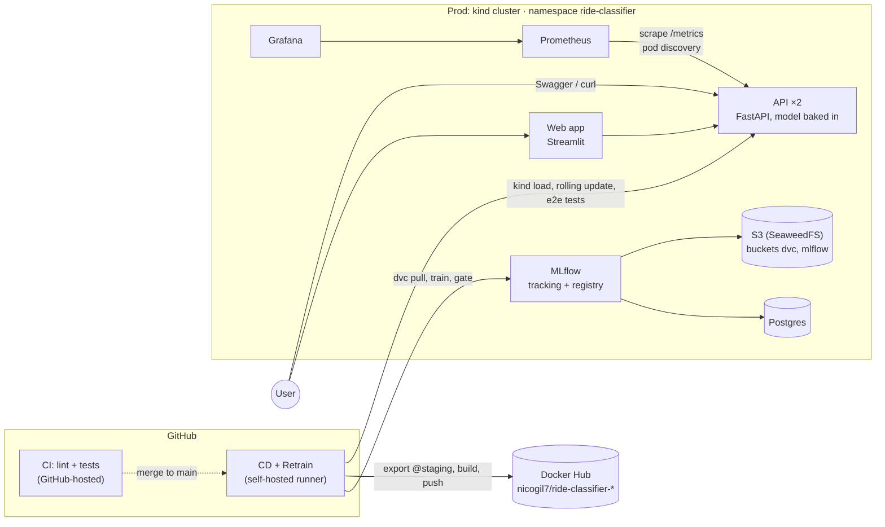
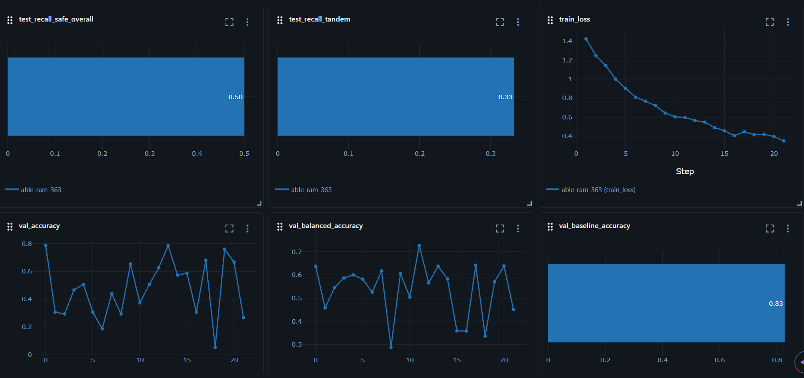
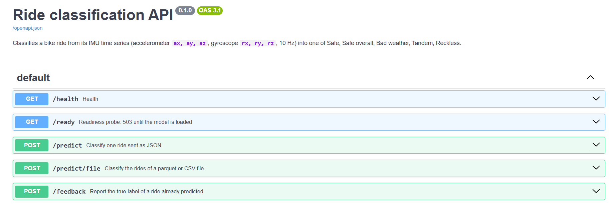
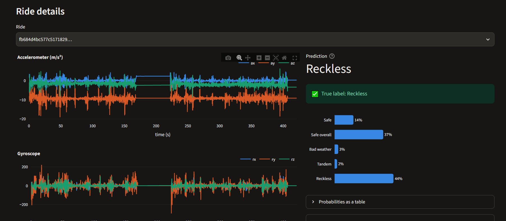
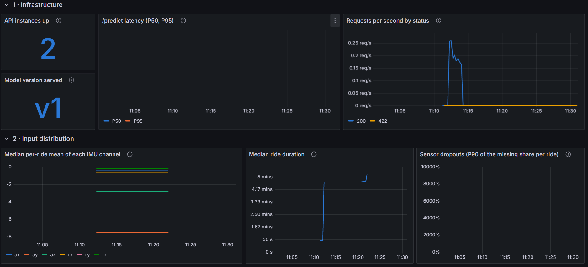
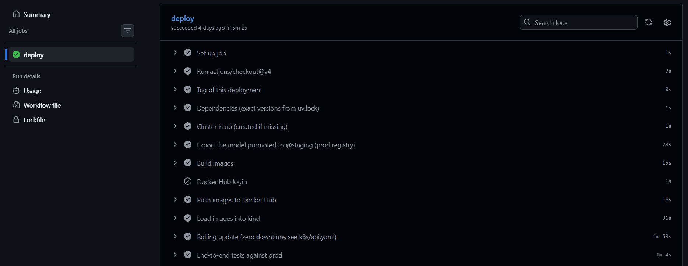
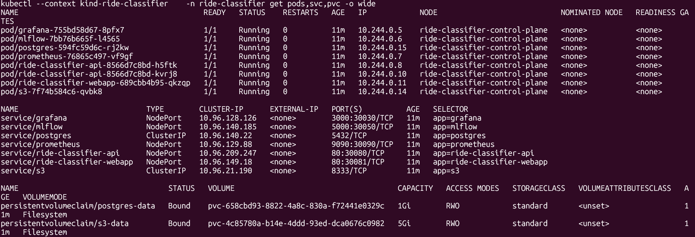

# Ride Classifier: MLOps & AI Infrastructure Project

[](https://github.com/Lavialle/MLOps-AI-infra-Project/actions/workflows/ci.yml)
[](https://github.com/Lavialle/MLOps-AI-infra-Project/actions/workflows/cd.yml)

End-to-end MLOps pipeline that classifies a bike ride into **Safe**, **Safe overall**, **Bad weather**, **Tandem**
or **Reckless** from its IMU time series (accelerometer `ax, ay, az`, gyroscope `rx, ry, rz`, 10 Hz).

It covers versioned data, a deep learning model tracked in MLflow, an evaluation gate, a FastAPI service and a
Streamlit app, Docker images on Docker Hub, a Kubernetes production environment, and CI/CD with automatic
deployment and retraining. Monitoring runs on Prometheus and Grafana.

> Albert School · MLOps & Model Deployment · final project

## Team

| Name |
|------|
| Nicolas Gilhodes |
| Ange Lavialle |
| Aymeric Mouttapa |
| Léon Pejic |

## What the brief asks, and where it is

| Requirement | Where |
|-------------|-------|
| 1. Extract the data | Raw files versioned with **DVC** on the S3 remote, validated and split by ride: [`data.py`](src/ride_classifier/data.py), [docs/data.md](docs/data.md) |
| 2. Deep learning classifier (5 classes) | **PyTorch 1D-CNN** on IMU windows: [`model.py`](src/ride_classifier/model.py), [`train.py`](src/ride_classifier/train.py), [docs/model.md](docs/model.md) |
| 3. Model stored on S3 | MLflow artifact store on the S3 bucket `mlflow` (SeaweedFS, see *Technical choices*) |
| 4. MLflow tracking and versioning | Params, per-epoch metrics, confusion matrices, model registry, evaluation gate, `@staging` alias |
| 5. API | **FastAPI** + Swagger: JSON ride or parquet/CSV upload, validation, metrics: [docs/api.md](docs/api.md) |
| Interactive web app | **Streamlit**, calls the API only: [`webapp/app.py`](webapp/app.py) |
| 6. Docker + Kubernetes via GitHub Actions (self-hosted runner) | Images on Docker Hub, local **kind** cluster, `cd.yml` on a self-hosted runner: [docs/docker.md](docs/docker.md), [docs/kubernetes.md](docs/kubernetes.md), [docs/cicd.md](docs/cicd.md) |
| 7. Versioned and documented on GitHub | One PR per step, CI on every PR, `docs/` |
| Pipeline DAG | **DVC** pipeline `split → train → evaluate`: [`dvc.yaml`](dvc.yaml), [docs/pipeline.md](docs/pipeline.md) |
| Tests | 73 unit + integration tests (CI) and 5 end-to-end tests run against prod after each deployment: [`tests/`](tests/) |
| **Bonus 1** Retraining pipeline | [`retrain.yml`](.github/workflows/retrain.yml): DVC pull → train → gate → promote → redeploy |
| **Bonus 2** Monitoring | **Prometheus + Grafana**, 4-layer dashboard, 8 alerts with runbooks: [docs/monitoring.md](docs/monitoring.md) |

## Architecture



The training pipeline is a DVC DAG: `raw data (DVC) → split (by ride) → train (MLflow run + new version) →
5-fold cross-validation → evaluation gate → @staging → export → API image`.

| Component | Dev (docker compose) | Prod (kind) |
|-----------|----------------------|-------------|
| S3 storage | SeaweedFS :8333 | SeaweedFS + PVC |
| Tracking + registry | MLflow + Postgres, http://localhost:5000 | MLflow + Postgres (PVC), http://localhost:5050 |
| API | http://localhost:8000/docs | 2 replicas, http://localhost:8080/docs |
| Web app | http://localhost:8501 | http://localhost:8081 |
| Monitoring | Prometheus :9090, Grafana :3000 | Prometheus (pod discovery), Grafana :3030 |

## Quickstart

Prerequisites: [uv](https://docs.astral.sh/uv/), Docker Desktop, [kind](https://kind.sigs.k8s.io/) (prod only).
`make help` lists every command.

**Dev**

```bash
make setup                 # Python 3.14 env (uv) + .env
make up                    # S3, Postgres, MLflow, Prometheus, Grafana
make pull                  # dvc pull: raw data from S3
make pipeline              # dvc repro: split -> train, cv -> evaluate (promotes @staging if the gate passes)
make export && make api    # API on http://localhost:8000/docs
make webapp                # web app on http://localhost:8501 (other terminal)
make test                  # unit + integration tests
```

**Prod (Kubernetes)**

```bash
make kind-up image image-webapp kind-load k8s-deploy   # whole stack in the kind cluster
make k8s-status            # pods, services, volumes
make e2e                   # end-to-end tests against prod
make simulate              # replay real rides -> Grafana dashboard
```

After the first deployment, **GitHub Actions** handles everything:
- every merge to `main` redeploys (`cd.yml`)
- *Actions → Retrain & redeploy* retrains and promotes a new model (`retrain.yml`)

## Results

**Model** (ride level; the baseline always predicts "Safe"):

| Split | Macro F1 | Balanced accuracy | Accuracy |
|-------|----------|-------------------|----------|
| Validation, 75 rides (best epoch 13) | **0.604** | 0.638 | 0.787 |
| Test (frozen split, 75 rides) | **0.329** | 0.331 | 0.733 |
| 5-fold CV, 500 rides (evaluation gate) | **0.371 ± 0.089** | 0.457 ± 0.148 | 0.654 ± 0.069 |
| Majority baseline | 0.181 | 0.200 | 0.827 |

Latest prod run (x86 laptop, [`reports/`](reports/)): this model is served in prod and baked into the Docker Hub
images since the CD runs of 26/11 (`latest`). The fixed reference of
[`ai-infrastructure/`](ai-infrastructure/) is the first v1, trained on an Apple M2: test macro F1 **0.317**,
balanced accuracy 0.458 (validation 0.567, best epoch 17).

The model clearly beats the baseline on the imbalance-aware metrics (macro F1, balanced accuracy). The baseline's
accuracy only reflects the 83 % share of Safe rides. Val and test hold a single Reckless ride each, so per-class
scores are noisy.

**5-fold cross-validation by ride** (`make cv`, all 500 rides tested once, [details](docs/model.md#cross-validation-how-noisy-is-one-test-split)):
macro F1 **0.371 ± 0.089** (baseline 0.182), balanced accuracy 0.457 ± 0.148, Reckless recall 3/6. Fold scores range
from 0.24 to 0.44: one 75-ride split is too noisy to judge a model, so the **evaluation gate now uses the
cross-validated mean** (≥ 0.25, baseline beaten in every fold) plus a sanity check of the promoted version on the
frozen test split. Next modelling step: data augmentation.

**Serving** (one process, laptop): `/predict` handles 16.5 rides/s with a P95 of 340 ms and 0 failures in a
1-minute Locust test (20 users). The whole test split (75 rides) goes through `/predict/file` in 1.1 s.

**Operations:**

| What | Result |
|------|--------|
| CD runs | Export from the prod registry, build, push, `kind load`, zero-downtime rolling update and 5/5 e2e tests on prod, in one workflow on the self-hosted runner |
| Retraining | Deterministic on a given machine: the same data and seed give the same scores in dev and prod. Across CPU architectures (ARM vs x86) floating-point rounding differs, so scores move slightly (test macro F1 0.317 vs 0.329) |

### Screenshots

| | |
|---|---|
| MLflow: runs, metrics per epoch, registry with `@staging`  | Swagger UI of the prod API  |
| Web app: signals, prediction, probabilities  | Grafana: 4-layer dashboard  |
| GitHub Actions: CD run on the self-hosted runner  | Kubernetes: pods of the prod namespace  |

## Technical choices

| Choice | Why |
|--------|-----|
| **Split by ride, stratified, ≥ 1 ride of each class per split** | Windows of one ride are correlated, so splitting by row would leak. With 6 Reckless rides, a random split often leaves val or test without any |
| **1D-CNN on 25.6 s windows, mean of window probabilities per ride** | Rides have 1,800 to 4,800 samples: windows give more training examples and a fixed input size. Global average pooling makes the network accept any length |
| **Class-weighted loss, early stopping and gate on macro F1** | 83 % of rides are Safe, so accuracy is meaningless. The gate requires a **cross-validated** mean macro F1 above a floor, the majority baseline beaten in every fold, and on the frozen test split for the promoted version |
| **One MLflow pyfunc = preprocessing + model** | Gap filling, the scaler fitted on train, windowing and aggregation travel with the weights, so serving cannot drift from training |
| **Model baked into the API image** | A tagged image is a frozen, reproducible model. Pods never depend on MLflow at runtime, and rolling back the model means rolling back the image |
| **SeaweedFS instead of MinIO** | MinIO stopped publishing images (`minio/minio` is gone from Docker Hub, Quay refuses anonymous pulls). SeaweedFS is the S3 store of the course labs, and all code speaks plain S3 (boto3, DVC, MLflow) |
| **kind + kustomize instead of Helm charts** | Same tooling as the labs. Plain manifests fit a 4 GB Docker VM, which full Helm charts such as kube-prometheus-stack (~1.5 GB) would not |
| **Self-hosted runner, never triggered by pull requests** | The cluster is local, so only a runner on that machine can deploy. Since the repo is public, forks must never run code on it |
| **Readiness (`/ready`) separate from liveness (`/health`)** | A pod without a model gets no traffic. Kubernetes does not restart it in a loop, because a restart would not fix a missing model |
| **No real data in published artifacts** | The MLflow input example is synthetic, and it is stripped from the exported model: the public images contain no course data |
| **Core dependencies + `dev` / `webapp` groups** | The API image installs the core only, and the web-app image has no torch or MLflow. CPU-only torch on Linux saves ~2 GB |

## Docker images

| Image | Docker Hub |
|-------|-----------|
| API (model baked in) | [`nicogil7/ride-classifier-api`](https://hub.docker.com/r/nicogil7/ride-classifier-api) |
| Web app | [`nicogil7/ride-classifier-webapp`](https://hub.docker.com/r/nicogil7/ride-classifier-webapp) |

Tags are the commit SHA (deployed by CD) and `latest`.

```bash
docker run -p 8000:8000 nicogil7/ride-classifier-api:latest       # http://localhost:8000/docs
docker run -p 8501:8501 -e API_URL=http://host.docker.internal:8000 nicogil7/ride-classifier-webapp:latest
```

## Data

| File | Content |
|------|---------|
| `GBG500.parquet` | 500 Gothenburg rides, 1.53 M IMU rows: the training data |
| `GBG500_labels.csv` | One label per ride: Safe 416, Safe overall 38, Bad weather 22, Tandem 18, Reckless 6 |
| `SRV3490.parquet` | 3,490 rides with a `topple` (fall) flag: not used for the 5-class task |

0.7 % of the rows are sensor dropouts, where all 6 channels are missing at once. They are interpolated inside
each ride, and a ride with more than 5 % missing samples is rejected. Details in [docs/data.md](docs/data.md).

## Repository layout

```
src/ride_classifier/   one module per step (python -m ride_classifier.<step>): data, features, model, train,
                       evaluate, export_model, simulate, client; api/ (main, schemas, metrics)
webapp/                Streamlit app
params.yaml, dvc.yaml  parameters and pipeline DAG
Dockerfile, docker/    API image, web app image, MLflow server image
k8s/                   prod manifests (kustomize)
infra/                 S3 and monitoring configs (shared by dev and prod)
tests/                 unit, integration, end-to-end
.github/workflows/     ci.yml, cd.yml, retrain.yml, publish-images.yml
docs/                  data, model, pipeline, api, docker, kubernetes, cicd, monitoring, runbooks
```

## Documentation

[Data](docs/data.md) · [Model & MLflow](docs/model.md) · [Pipeline](docs/pipeline.md) · [API](docs/api.md) ·
[Docker](docs/docker.md) · [Kubernetes](docs/kubernetes.md) · [CI/CD](docs/cicd.md) ·
[Monitoring](docs/monitoring.md) · [Runbooks](docs/runbooks.md) · [Contributing](CONTRIBUTING.md)

**AI Infrastructure contribution** (resource sizing, benchmarks, optimization, distributed training, cost): [ai-infrastructure/](ai-infrastructure/README.md)
