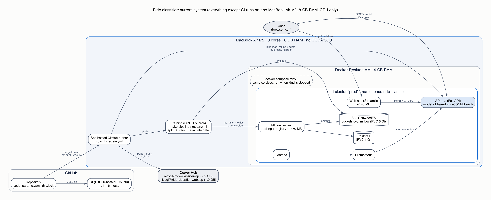

# Current system: inventory and resources

This is the system **as implemented today** (model v1), not the proposed future architecture. That one is in
[`cost-resilience/`](../cost-resilience/). Each number is labelled with how it was obtained:

- **measured**: run on the reference machine, with the source and date
- **observed**: seen once in a log or run, not yet a controlled benchmark
- **from config**: read from the repository

*Source: [`current-system.dot`](current-system.dot), rendered with `make infra-diagrams`.*

## Components

| Brief component | Our implementation | Technology | Where it runs |
|-----------------|--------------------|------------|---------------|
| Preprocessing | Validation, gap interpolation, split by ride, 25.6 s windows, channel scaler fitted on train | pandas, NumPy ([`data.py`](../../src/ride_classifier/data.py), [`features.py`](../../src/ride_classifier/features.py)) | laptop CPU, at training time; **inside the model artifact** at serving time |
| Training | 1D-CNN, class-weighted loss, early stopping on validation macro F1 | **PyTorch 2.15** ([`train.py`](../../src/ride_classifier/train.py)) | laptop CPU (`make pipeline`, or `retrain.yml` on the self-hosted runner) |
| Model storage and versioning | MLflow tracking + registry, artifacts on S3, evaluation gate, alias `@staging`; data versioned with DVC | MLflow 3.18, SeaweedFS (S3), Postgres, DVC | kind cluster on the laptop (prod), docker compose (dev) |
| Prediction API | `/predict` (JSON), `/predict/file` (parquet/CSV), `/ready`, `/health`, `/metrics` | FastAPI + MLflow pyfunc, 2 replicas | kind cluster on the laptop |
| Web app | Upload or example rides, signals, prediction, feedback | Streamlit | kind cluster on the laptop |
| Docker | API image with the model baked in; web app image | `python:3.14-slim`, uv, CPU-only torch | built on the laptop, published on Docker Hub |
| CI/CD | CI: lint + tests. CD: export, build, push, `kind load`, rolling update, e2e tests, rollback. Retraining workflow | GitHub Actions: GitHub-hosted runner (CI), **self-hosted runner on the laptop** (CD, retrain) | GitHub + laptop |
| Monitoring | 4-layer dashboard, 8 alerts with runbooks | Prometheus, Grafana | kind cluster on the laptop |

**Where the model runs:** training and inference both run **on the CPU of one laptop**. No GPU is used, and Colab
and GCP are not used by the current system. A laptop GPU (RTX 3060) is used only for the GPU measurement of step 4.

## Resources

### Data

| Item | Value | How |
|------|-------|-----|
| Raw dataset `GBG500.parquet` | 30.2 MB on disk, 1,529,547 rows × 8 columns, 500 rides | measured (file size, row count) |
| Labels `GBG500_labels.csv` | 500 rows, 5 classes: Safe 416, Safe overall 38, Bad weather 22, Tandem 18, Reckless 6 | measured |
| Splits (by ride) | train 350 rides / 21.4 MB · val 75 / 5.3 MB · test 75 / 5.3 MB | measured |
| Model input | one window = **6 channels × 256 samples** (25.6 s at 10 Hz), float32 = 6 KB | from config (`params.yaml`) |
| Training tensor | 7,833 windows × 6 × 256 × 4 bytes = **48.1 MB** | calculated, from the measured window count |
| Unused dataset `SRV3490.parquet` | 268.2 MB, 16.9 M rows, 3,490 unlabelled rides → ~127k windows (0.8 GB) | measured, candidate for phase B |

### Model

| Item | Value | How |
|------|-------|-----|
| Architecture | 3 × (Conv1d + BatchNorm + ReLU), global average pooling, dropout, linear | from code ([`model.py`](../../src/ride_classifier/model.py)) |
| Parameters | **37,477** | measured (`environment.md`) |
| Weights file `weights.pt` | **159 KB** (158,750 bytes) | measured |
| Full MLflow model directory | 872 KB (weights, pickled wrapper with the scaler, environment files) | measured |
| Training run | about 2.5 min on the M2 CPU, best epoch 17, early stopping at 25; batch size 64 | observed (MLflow run of 22/11); **measured in step 4** |

### Serving

| Item | Value | How |
|------|-------|-----|
| API image | 2.47 GB in Docker Desktop's listing; `.venv` inside it is 1.7 GB, of which torch 695 MB | measured 22/11 (`docker images`, `du` in the container) |
| Web app image | 0.96 GB (no torch, no MLflow) | measured 22/11 |
| API memory | ~550 MB per replica with the model loaded | measured 22/11 (`docker stats`) |
| API throughput (HTTP) | 16.5 rides/s, median 78 ms, **p95 340 ms**, 0 failures: one uvicorn process, Locust 20 users for 1 min, rides of ~3,000 samples | measured 22/11 (`make load`, `reports/load_stats.csv`) |
| Pod resources | API: requests 250m CPU / 640 Mi, limits 1 CPU / 1 Gi, × 2 replicas. All 8 running pods together fit in the 4 GB Docker VM (~2.5 GB used) | from config + measured 22/11 |

**What stands out:** the model is **159 KB**, but serving it costs **~550 MB of RAM and a 2.5 GB image**. The
footprint comes from the runtime (PyTorch, MLflow, pandas), not from the model. Step 3 (optimization) targets this.

## Is a single machine sufficient?

**Yes, for the current workload.** The evidence:

- **Training** fits easily. The whole training tensor is 48 MB, the model has 37k parameters, and one run takes
  minutes on a laptop CPU. Under the ZeRO model-state formula of the course (16 bytes per parameter with Adam), the
  model state is about 0.6 MB (calculated in step 4).
- **Serving** is handled by 2 small CPU replicas that also fit, with the rest of the stack, in a 4 GB VM. One
  replica alone serves 16.5 rides/s.
- **The limits are elsewhere:**
  - The laptop is also the cluster and the CI/CD runner: it is a single point of failure with no redundancy.
  - Retraining blocks the machine.
  - RAM is the scarce resource. The kind cluster and the dev stack cannot run together, and Docker reserves 4 of
    the 8 GB.

This answer changes if the unlabelled dataset is used (phase B): 17× more training windows, 0.8 GB of data, and
pre-training estimated at around 30–40 min on CPU. Step 4 measures the per-epoch time on CPU and on one GPU.

## Gaps measured in the next steps

| Gap | Step |
|-----|------|
| Inference latency without HTTP, split between preprocessing and the network, by batch size | 2. Baseline |
| Inference with ONNX Runtime: latency, memory, image size, same predictions | 3. Optimization |
| Training time and peak memory, CPU vs GPU, repeated 3 times | 4. Distributed training |
| Autoscaling under load, a real rollback, cloud cost estimates | 5. Scaling, cost, resilience |
