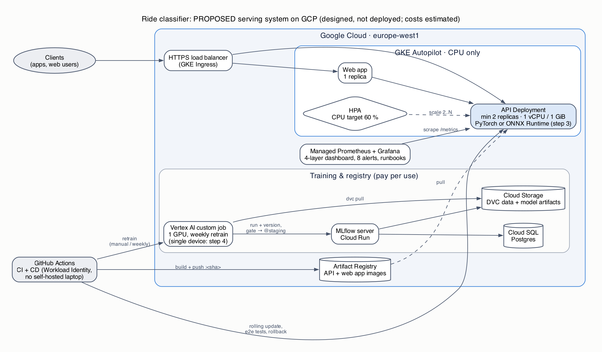

# Scaling, cost and resilience plan

The **proposed** serving system for a real deployment. It differs from the current system (one laptop, see
[`../architecture/current-system.md`](../architecture/current-system.md)). Labels as everywhere in this folder:
- **measured**: run by us, raw data committed
- **designed**: not deployed
- **estimated**: built on the assumptions stated next to it

Nothing here claims a real cloud deployment or real autoscaling unless it is marked *measured*.

## 1. Proposed architecture (designed)

| Concern | Current (laptop) | Proposed (GCP, one region) | Why |
|---------|------------------|----------------------------|-----|
| API serving | 2 pods on kind | **GKE Autopilot** Deployment, CPU only, **HPA** on CPU | Measured (step 2): the network is ~80–93 % of each request, but only ~15 ms per ride on one laptop CPU, so one CPU pod serves tens of rides/s. Whether a GPU pays off is measured on Colab (step 4) before deciding. CPU pods scale horizontally |
| Model runtime | PyTorch in a 2.5 GB image | PyTorch, or ONNX Runtime if step 3 confirms the gain | smaller image means faster scale-out and more pods per node |
| Web app | kind pod | same cluster, 1 replica | low traffic, stateless |
| Images | Docker Hub | Artifact Registry, same region | pull speed when scaling out |
| Model registry | MLflow + Postgres + SeaweedFS | MLflow on Cloud Run + Cloud SQL (Postgres) + **Cloud Storage** | managed storage, backups |
| Data versioning | DVC on local S3 | DVC remote on Cloud Storage | same code: the S3 API is replaced by GCS |
| Training / retraining | laptop CPU, self-hosted runner | Vertex AI custom job, or a Colab-class single GPU for phase B | one device is enough (step 4); pay only during the run |
| Monitoring | Prometheus + Grafana in kind | Google Managed Prometheus + the same Grafana dashboard and alerts | same 4 layers, managed storage |
| CI/CD | GitHub Actions + self-hosted runner | GitHub Actions with Workload Identity Federation (no runner on a laptop) | removes the laptop as a single point of failure |

## 2. Request scaling (designed; inputs measured)

The sizing rule is **replicas = peak load ÷ (throughput per replica × target utilisation)**.

| Input | Value | How |
|-------|-------|-----|
| Throughput of one replica through HTTP | **16.5 rides/s**, p95 340 ms (one uvicorn process, Locust 20 users) | measured 22/11 (`make load`) |
| Throughput of the model alone, 1 thread | PyTorch **41.5 rides/s**, p95 37.5 ms · ONNX Runtime **222 rides/s**, p95 5.6 ms (1 ride per request) | measured (steps 2 and 3, 25/11, quiet machine) |
| Target CPU utilisation | 60 % | design choice: room for spikes while new pods start |
| Minimum replicas | 2 | resilience: one pod can fail or roll |
| Scale-out signal | HPA on CPU at 60 %; later on request rate | designed |

**Capacity of the minimum deployment** (*calculated* from the measured HTTP throughput): one replica at 60 %
handles 16.5 × 0.6 ≈ **9.9 rides/s**. The 2 replicas kept for resilience therefore absorb **≈ 20 rides/s at
peak**, which with a 10× peak-to-average ratio is **≈ 170,000 rides/day**: 17× the traffic assumed below. Our
costs are therefore set by the minimum always-on footprint, not by load, and autoscaling only matters far
above the expected traffic. A GPU for serving is not justified: one CPU replica already has an order of
magnitude of headroom.

**Autoscaling test in kind** (*pending*): install metrics-server, add the HPA, ramp up Locust, and record the
replica count and p95 over time. Until that run exists, autoscaling is a design, not a result.

## 3. Costs (estimated, to be checked)

Assumptions, stated before any number:

| Assumption | Value |
|------------|-------|
| Region | europe-west1 (Belgium) |
| Traffic | 10,000 rides/day, peak 10× the average (≈ 1.2 rides/s at peak) |
| Serving | 2 replicas × 1 vCPU / 1 GiB, 24/7 (730 h/month) |
| Retraining | 1 run per week on 1 T4 GPU, 1 h per run |
| Storage | 1 GB data + models, monthly growth negligible |

Unit prices used (looked up on Google's official pricing pages on **25/11/2026**). The pages show one region at a
time, and **we could not obtain the europe-west1 rows**. Each price below names the region it comes from. European
prices are typically somewhat higher, so this total is a lower-bound estimate until the europe-west1 rates are read
in the pricing calculator.

| Unit price | Value | Region of the price | Source |
|------------|-------|---------------------|--------|
| GKE Autopilot, general-purpose pod vCPU | $0.0445 / vCPU-hour | us-west8 (Phoenix) | [GKE pricing](https://cloud.google.com/kubernetes-engine/pricing) |
| GKE Autopilot, general-purpose pod memory | $0.0049225 / GiB-hour | us-west8 (Phoenix) | [GKE pricing](https://cloud.google.com/kubernetes-engine/pricing) |
| Cloud SQL `db-f1-micro` (shared core) | $0.0105 / hour | listed price, page possibly dated | [Cloud SQL pricing](https://cloud.google.com/sql/pricing) |
| Cloud Storage, Standard | $0.020 / GB-month | us-east1 example | [Cloud Storage pricing examples](https://cloud.google.com/storage/pricing-examples) |
| NVIDIA T4, on demand | $0.35 / GPU-hour (Colab and Dataflow list $0.42) | us-west8 (Phoenix) | [GPU pricing](https://cloud.google.com/products/compute/gpus-pricing), [Colab pricing](https://cloud.google.com/colab/pricing) |

| Item | Monthly estimate (USD) | How |
|------|-----------------------:|-----|
| API: 2 pods × (1 vCPU, 1 GiB), 730 h | 72.16 | 2 × 730 × (0.0445 + 0.0049225) |
| Web app: 1 pod × (0.25 vCPU, 0.5 GiB) | 9.92 | |
| MLflow server: 1 pod × (0.5 vCPU, 1 GiB) | 19.84 | in the same Autopilot cluster |
| Prometheus + Grafana: 2 pods × (0.25 vCPU, 0.5 GiB) | 19.84 | self-hosted, as today (managed Prometheus is billed per sample) |
| Cloud SQL Postgres `db-f1-micro` | 7.67 | 730 h × 0.0105. Google flags shared-core machines as dev/test only: a production database costs more |
| Cloud Storage, 1 GB | 0.02 | |
| Retraining, 4 h of T4 per month | 1.40 | GPU only, host VM excluded |
| **Total** | **≈ 131** | *estimated*, lower bound (see region caveat) |

**Reading the estimate:**
- **About 55 % is the 2 always-on API replicas,** which are there for availability, not load.
- **Retraining on a GPU costs about $1.40/month,** negligible next to serving.
- **The biggest lever is the size of each pod.** That is why the memory and image-size results of step 3
  (ONNX Runtime) matter more for cost than latency does.

Not included:
- the GKE cluster management fee (an hourly fee per cluster, partly offset by a monthly free-tier credit; check
  the GKE pricing page)
- network egress
- Artifact Registry storage
- logging

Before any real cloud run, the remaining GCP credits are checked, and the resources are deleted afterwards.

## 4. Failure recovery and rollback

What already exists, and what we test:

| Failure | Mechanism | Status |
|---------|-----------|--------|
| A new image breaks the API | CD runs e2e tests on prod after the rolling update; on failure, `kubectl rollout undo` | implemented. **Deliberate failing deploy: pending** (records the time back to a healthy state) |
| A pod without a model | readiness `/ready` = 503, so it gets no traffic; liveness `/health` does not restart it in a loop | implemented, tested (unit + e2e) |
| A pod crashes or is OOMKilled | Deployment recreates it; 2 replicas, rolling updates with `maxUnavailable: 0` | implemented |
| A worse model | evaluation gate on the test split (macro F1 ≥ floor and > baseline) before `@staging`; previous image tag on Docker Hub | implemented, tested (gate) |
| Silent input drift (e.g. unit bug) | `InputGravityShift` alert + runbook | **measured**: fired after ~12 min of simulated unit-bug traffic (22/11) |
| Laptop down | everything stops: a single point of failure | accepted for the course; removed in the proposed design |

**Rollback procedure** (manual, when CD did not catch the problem):
1. `kubectl -n ride-classifier rollout undo deploy/ride-classifier-api`, or redeploy a known tag with
   `make k8s-deploy TAG=<sha>`.
2. Check `/ready`, `make e2e`, and the Grafana dashboard.
3. If the model is at fault, move the `@staging` alias back to the previous version in MLflow, then run CD.
