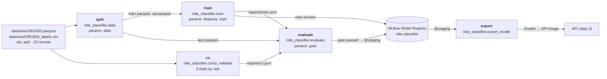

# Training pipeline (DAG)

The pipeline is a **DVC DAG** defined in [`dvc.yaml`](../dvc.yaml), as in the course labs. DVC tracks the
dependencies, parameters and outputs of every stage. `dvc repro` only re-runs the stages whose inputs changed,
for example code, data or a section of `params.yaml`.



| Stage | Command | Depends on | Produces | Re-runs when |
|-------|---------|------------|----------|--------------|
| split | `python -m ride_classifier.data` | raw data, `data.py` | `data/processed/{train,val,test}.parquet` | raw data, split code or `params.data` change |
| train | `python -m ride_classifier.train` | train/val splits, `train.py`, `model.py`, `features.py` | MLflow run + registered version, `reports/train.json` | splits, model code, `params.features` or `params.train` change |
| cv | `python -m ride_classifier.cross_validate` | raw data, training code, `params.data/features/train`, `gate.cv_folds` | `reports/cv.json` (5 folds, mean ± std, per-class recall over all rides) | data, training code or training parameters change |
| evaluate | `python -m ride_classifier.evaluate` | test split, `reports/train.json`, `reports/cv.json`, `evaluate.py` | test metrics, gate tag, `@staging` alias, `reports/eval.json` | a new model or `params.gate` change |

`export` is not a DVC stage. It reads a registry alias, which DVC cannot track, so it runs after the pipeline (`make export`).
In CI (step 8), the GitHub Actions workflow runs the same sequence: `dvc pull` → `dvc repro` → `make export` →
build and push the image → deploy.

## Commands

```bash
make up          # S3 + MLflow (train/evaluate log to MLflow)
make pull        # dvc pull: raw data from the S3 remote
make pipeline    # dvc repro: split -> train, cv -> evaluate (only what changed)
make dag         # print the DAG
uv run dvc metrics show   # reports/train.json + reports/cv.json + reports/eval.json
uv run dvc params diff    # parameter changes since the last commit
make export      # @staging -> ./model
```

`evaluate` exits with code 1 when the gate fails. `dvc repro` then stops, and so will the CI.

## Reproducibility

Each MLflow run is tagged with `git_commit` and `data_md5`. `dvc.lock` pins the hash of every input and output.
To reproduce any model version:

```bash
git checkout <git_commit of the run>
uv run dvc pull
uv run dvc repro
```
